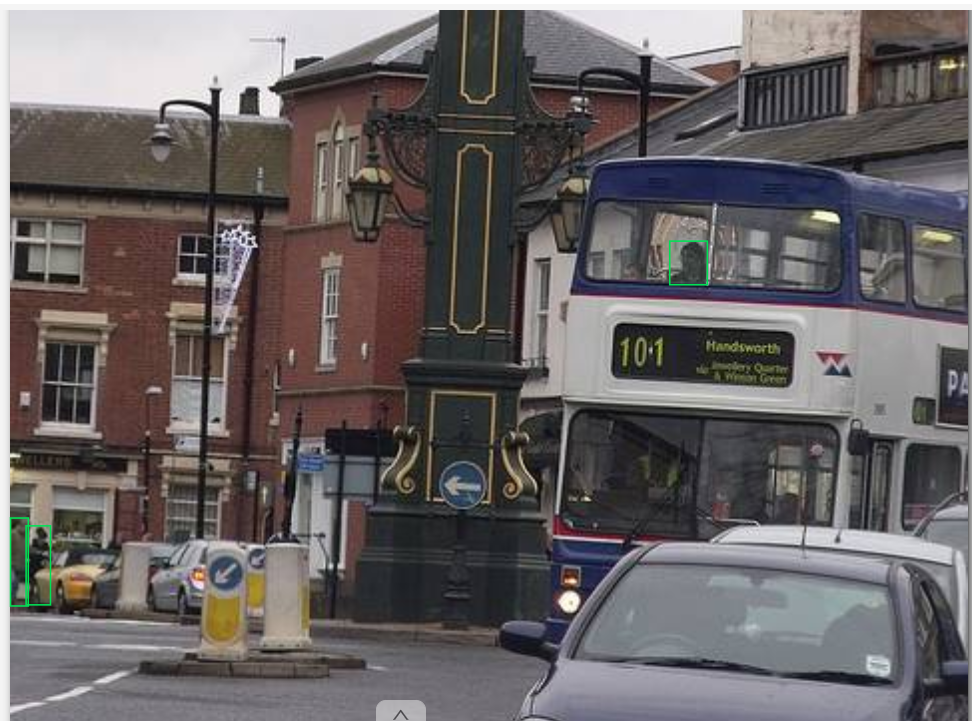

# Báo cáo Day 09 — Ninh Hải Nam (2A202603276)

## 1. Kết luận trước

Pipeline nhận 193/224 ảnh; 31 ảnh bị loại ở bước intake do ảnh hỏng, quá nhỏ, trùng hoặc trùng với tập val/test. Dataset `clean_v1` được xuất với 193 ảnh. Sau vòng duyệt mô phỏng không còn lỗi bắt buộc, nhưng 34/193 ảnh vẫn còn cảnh báo chưa duyệt (17,62%), cao hơn ngưỡng 10%. Vì vậy kết luận là **Hold**; dataset xuất ra chỉ là bản nháp, chưa được phát hành.

## 2. Lỗi và phân việc

Bảng dưới đếm các bản ghi trong `02_error_list_v1.csv`. Các mã theo dòng là số dòng nhãn, các mã theo ảnh là số ảnh.

| Mã lỗi | Số bản ghi | Ai xử lý | Cách xử lý |
|---|---:|---|---|
| `BAD_SIZE` (3), `CORRUPT_IMAGE` (2) | 5 | Máy | Loại ảnh quá nhỏ hoặc không mở được. |
| `DUP_IMAGE_EXACT` (8), `DUP_IMAGE_NEAR` (7), `LEAK_TEST` (11) | 26 | Máy | Loại ảnh trùng hoặc trùng với tập val/test. |
| `BAD_CLASS_ID` (6), `BAD_FORMAT` (3), `BOX_ZERO` (4), `DUP_BOX` (7) | 20 | Máy | Xóa dòng nhãn lỗi; số dòng và thay đổi được ghi trong log. |
| `BOX_OUT_OF_IMAGE` | 8 | Máy | Cắt box vào trong ảnh; xem trước/sau ở `03_fixes.csv`. |
| `BAD_CLASS_NAME` | 2 | Máy | Sửa tên lớp trong `data.yaml` theo đúng thứ tự. |
| `MISSING_LABEL_FILE` | 6 | Người | Tôi không để máy tự tạo nhãn; các ảnh này cần người gán nhãn. |
| `POSSIBLE_MISSING` (53), `POSSIBLE_WRONG_CLASS` (17), `POSSIBLE_LOOSE_BOX` (27), `POSSIBLE_FALSE_POS` (28) | 125 | Người | Đây là cảnh báo từ model, cần xem ảnh để xác nhận. |
| `BOX_TINY` (6), `BOX_HUGE` (3), `EMPTY_LABEL` (11), `CLASS_RARE` (4) | 24 | Người xem xét | Giữ nguyên để người kiểm tra; `CLASS_RARE` là cảnh báo ở mức dataset. |

Tổng cộng có 67 lỗi bắt buộc và 149 cảnh báo trong file v1; trong đó 31 lỗi intake đã khiến 31 ảnh bị loại trước QC. Hàng đợi có 121 ảnh. `img_0020` đứng đầu với priority 11.524 do có `FIXED_DROP_LINE`, `POSSIBLE_MISSING` và `POSSIBLE_WRONG_CLASS`. Ngân sách mô phỏng là 80 ảnh; 74/80 ảnh đầu hàng đợi có ít nhất một cảnh báo ngữ nghĩa.

## 3. Calibration (2 ngưỡng)

| Tham số | Ban đầu → chọn | Precision / Recall trước → sau | Lý do chọn |
|---|---|---|---|
| `duplicates.phash_dist` | 2 → **16** | `DUP_IMAGE_NEAR`: 1.00/0.50 → 1.00/0.83 | Ở 16, calib bắt được 5/6 ảnh gần trùng và không có FP. Ở 20, recall giảm còn 0.50. |
| `second_opinion.conf` | 0.25 → **0.6** | `WRONG_CLASS`: .56/.83 → .62/.83; `MISSING`: .50/1.00 → .57/1.00; `LOOSE_BOX`: .29/.40 → .20/.20; `FALSE_POS`: .31/1.00 → .31/1.00 | Mức 0.6 cải thiện precision của cảnh báo nhầm lớp và thiếu nhãn, đồng thời giữ recall thiếu nhãn ở 1.00. Đổi lại, model bắt box lỏng kém hơn. |

Bộ calib chỉ có 39 ảnh. Với pHash 16, vẫn có 1/6 lỗi ảnh gần trùng bị bỏ sót. Calib cũng không có lỗi `LEAK_TEST`, và lỗi nhầm lớp được chèn chưa đại diện hết các trường hợp nhầm car/truck/bus trong raw. Vì vậy tôi xem các chỉ số này là căn cứ chọn ngưỡng, không phải bảo đảm cho toàn bộ dữ liệu thật.

## 4. Cửa chặn và điểm mù

Để kiểm tra gate, tôi chạy `python -m pipeline.run --budget 0 --reports work/rep_nb --export-dir work/exp_nb`. Pipeline còn 6 lỗi bắt buộc, kết luận **Rework**, mã thoát **20**, và không xuất `work/exp_nb/clean_v1`. Ở lần chạy chuẩn, người duyệt mô phỏng xử lý 80 ảnh; vòng cuối không còn lỗi bắt buộc nhưng kết luận vẫn là Hold do còn cảnh báo ở 34/193 ảnh.

Hai điểm mù có số liệu: (1) `DUP_IMAGE_NEAR` ở ngưỡng 16 có recall 0.83 trên 6 mẫu calib, tức còn bỏ sót 1 mẫu. (2) Với confidence 0.6, `POSSIBLE_LOOSE_BOX` có recall 0.20 trên 5 lỗi calib, tức bỏ sót 4 mẫu. Model chỉ đưa ý kiến để người kiểm tra, không thay thế việc xem box.

## 5. Train: raw vs clean (Colab)

**Chưa chạy.** Tôi sẽ chạy phần so sánh trên Google Colab với GPU T4 theo `notebooks/day09_train_compare.ipynb`, vì máy local không dùng để train. Sau khi chạy đủ 2 seed cho raw và clean, tôi sẽ bổ sung bảng từ `submission/results/comparison.md` và so chênh lệch mAP với độ lệch giữa các seed. Hiện chưa có số liệu nên chưa kết luận clean tốt hơn raw.

## 6. Quyết định và ghi chú AI

Tôi giữ kết luận **Hold**. Để đạt Release, cần người xem và xử lý cảnh báo sao cho số ảnh còn cảnh báo chưa duyệt giảm xuống tối đa 19/193. Nếu ngân sách duyệt không đủ thì tôi sẽ giữ Hold, không đổi ngưỡng gate.

- Tôi dùng AI để hỗ trợ viết bốn module còn thiếu theo docstring, test và quy tắc của lab.
- Tôi kiểm tra từng module bằng test riêng, sau đó chạy toàn bộ test (80 passed), calibration, pipeline và trường hợp gate với ngân sách 0.
- Bản AI đề xuất ban đầu dùng `ds.stem`, nhưng `Dataset` không có phương thức đó. Tôi kiểm tra `common.py`, đổi sang `image_path.stem` rồi mới chạy test.

**CVAT bonus (+2):** Trên `img_0051`, bộ lọc `width < 20` tìm được 3 box. Pipeline chỉ báo `BOX_TINY` ở dòng 5 (cạnh ngắn 8,91 px); hai box còn lại rộng dưới 20 px nhưng không dưới ngưỡng 12 px của pipeline. `can_review` là thuộc tính để người gán đánh dấu object cần xem lại; trong pipeline, ảnh được ưu tiên qua `05_review_queue.csv`, mã cảnh báo và ngân sách duyệt.

